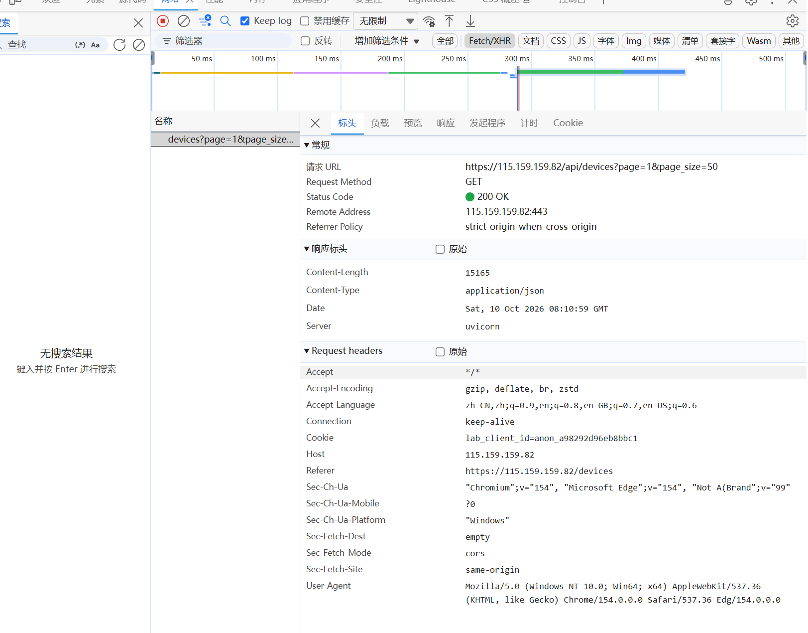
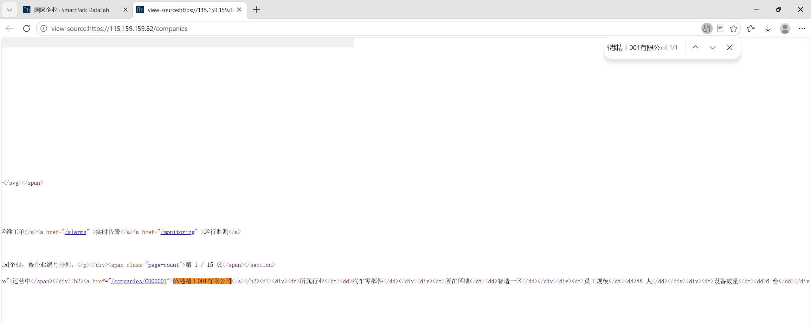
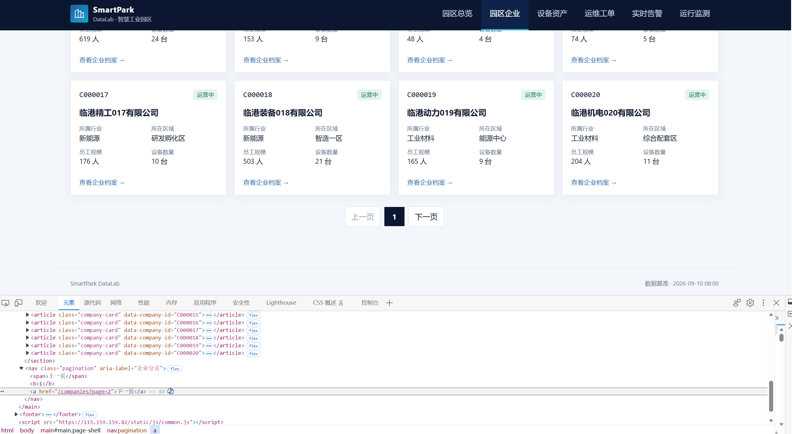
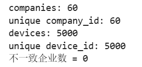

# Lab 1 实验报告

## 学生信息

- **姓名：徐祗莹**
- **学号：112404260104**
- **班级：数据1241**
- **GitHub 用户名：xu150**
- **仓库地址：https://github.com/xu150/bigdata-collection-labs-112404260104

---

# 任务 1：判断数据加载方式

## 1.1 Device：判断动态加载并找到 API

### 判断结果

- 页面：`/devices`
- 数据加载方式：`动态加载`
- 判断依据：1. 在“查看网页源代码”中不能搜索到页面上的设备名称；
2. 在 Network 的 Fetch/XHR 中可以找到返回设备数据的请求。


### API 信息

- Request URL：https://115.159.159.82/api/devices?page=1&page_size=50
- Request Method：GET
- Query 参数：page=1&page_size=50

### 【截图 1】Device API 发现证据

文件名：


## 1.2 Company：判断静态加载

- 页面：`/companies`
- 数据加载方式：`静态加载 `
- 判断依据：使用“右键 → 查看网页源代码”后，能搜索到页面中真实显示的企业名称。

### 【截图 2】Company 静态加载证据

文件名：


# 任务 2：Device API 分页采集

## 2.1 API 分页结构


| 含义 | JSON 字段 |
|---|---|
| 当前页 | page|
| 每页条数 | page_size|
| 设备总数 |total|
| 设备列表 |items |

---

## 2.2 关键代码

只填写分页采集的核心部分，不要粘贴整个 Notebook。

```python
# 从第一页响应中读取分页信息
total = data["total"]
page_size = data["page_size"]

total_pages =(total + page_size - 1) //page_size

devices = []

for page in range(1, total_pages + 1):
    r = requests.get(
        api_url,
        params={
            "page": page,
            "page_size": page_size
        },
        timeout=10
    )

    page_data = r.json()
    page_items = page_data["items"]
    devices.extend(page_list)
print("最终采集设备数量：", len(devices))

---

## 2.3 采集结果

- 每页条数：50
- 设备总数：5000
- 程序计算得到的总页数：100
- 最终采集设备数：5000
- 唯一 `device_id` 数：5000

回答：

> 为什么总页数应由 API 返回的 `total` 和 `page_size` 计算，而不是直接在代码里写死？

答：动态计算总页数可以适配后端数据量变化。如果硬编码写死总页数，当设备总数增减时，会出现漏爬数据或者请求无效页面的问题；通过 API 返回的`total`和`page_size`实时计算，程序能自动算出需要请求多少页，保证完整采集。

---

# 任务 3：Company HTML 解析

## 3.1 企业记录 Selector

- 企业记录 selector：
- 第 1 页企业记录数：20

说明为什么选择这个 selector：`article.company-card`

- 主要使用了 `id / class / data-* / 父子层级` 中的哪一种？
- 是否参考过浏览器 Copy selector 或 AI？
- 最终为什么采用现在这个写法？

答：
1. 主要使用了 `class` 选择器。
3. 少量参考浏览器Copy selector，自行修改优化。
4. 浏览器复制出来的选择器层级冗长，稳定性差。`article.company-card`写法简洁，直接通过标签+class定位卡片，页面小幅结构改动时不容易失效，鲁棒性更好。

---

## 3.2 关键代码


```python
cards = soup.select("article.company-card")

card = cards[0]

company_id = card.get("data-company-id")
name =card.select_one("h2 a").get_text(strip=True)
status =card.select_one(".badge").get_text(strip=True)
```


```python
industry = details["所属行业"]
zone =details["所在区域"]
device_count = int(details["设备数量"].replace("台","").strip())
```

---

## 3.3 字段来源说明

任选 **2 个字段**说明：

1. 字段：企业ID（company_id）
   - 来自：`文本 / HTML 属性`
   - 使用的方法：通过 `card.get("data-company-id")` 获取 article 标签上的 data-company-id 属性值。

2. 字段：企业名称（name）
   - 来自：`文本 / HTML 属性`
   - 使用的方法：`card.select_one("h2 a").get_text(strip=True)`，选中h2下a标签，提取内部文本并去除首尾空白。

---

# 任务 4：Company “下一页”分页

## 4.1 下一页元素

- “下一页” selector：
- 第 1 页 `href` 示例：`/companies?page=2`

### 【截图 3】Company “下一页”元素

文件名：

---

## 4.2 关键代码

```python
next_link = soup.select_one("".pagination"")

next_href = next_link.get("href")

next_url = urljoin(
    current_url,
    next_href
)
```


> 你的程序如何完成“当前页 → 找下一页 href → 请求下一页 → 再解析”的循环？

答：程序解析当前页面后，查找文字为 “下一页” 的 a 标签获取 href。使用`urljoin`拼接出完整下一页网址，发起新请求得到下一页 HTML。循环重复解析、查找下一页的逻辑，找不到下一页链接时终止采集。

---

## 4.3 三页采集结果

| 页码 | 企业数 |
|---|---:|
| 1 |20|
| 2 |20 |
| 3 |20|
| **合计** | 60|

- 唯一 `company_id` 数：60

---

# 任务 5：结果验证

## 5.1 最终结果

| 检查项 | 结果 |
|---|---:|
| Company 总数 | 60|
| 唯一 `company_id` |60 |
| Device 总数 |5000 |
| 唯一 `device_id` |5000 |
| Company–Device 不一致企业数 |0|

### 【截图 4】最终验证结果

文件名：


## 5.2 一致性检查关键代码

```python
from collections import Counter

device_counts = Counter(
    x["company_id"] for x in devices
)

mismatch_count = 0

for company in companies:
    cid =  comp["company_id"]
    expected = comp["device_count"]
    actual = device_counts.get(cid, 0)

    if expected != actual::
        mismatch_count += 1
```

回答：

> 为什么 `status_code == 200` 仍然不能说明“数据已经采集正确”？

答：`status_code == 200`仅代表服务器正常返回响应，仅说明网络请求成功。无法保证返回的网页内容完整、目标字段存在，页面可能为空、结构异常，提取的数据可能缺失或错误，因此不能代表采集数据正确。

---

# 任务 6：保存采集结果

确认已经生成：

```text
data/companies.json
data/devices.json
```

填写：

- `companies.json`：`已生成 `
- `devices.json`：`已生成 `


# 实验结论

用 **80～150 字**总结：

1. 静态加载与动态加载页面的处理方式有什么不同；
2. HTML “下一页”分页和 API `page` 分页有什么不同；
3. 你使用了哪些方法验证采集结果。

答：1.本次实验针对两种网页采用不同抓取策略，静态页面可直接解析返回的 HTML 提取数据；动态页面需处理接口请求获取数据。2.HTML “下一页” 分页通过点击翻页改变页面 DOM，API page 分页直接请求接口参数获取数据。3.本次通过统计企业与设备 ID 去重数量、比对企业标注设备数和实际抓取设备数进行一致性校验，最终将采集数据持久化保存至 JSON 文件，验证爬虫采集结果是否完整准确。
