# 实验二报告：房源采集与 MySQL 存储

- 班级：数据1241
- 姓名：徐祗莹
- 学号：112404260104
- 实验日期：2026年11月6日
- GitHub 仓库链接：bigdata-collection-labs-112404260104
- 源码文件名：anjuke.ipynb
- 数据库与表：`smartpark_lab.houseinfo`
- 数据来源：在线教学站 
- 访问时间及结果（若失败，填写状态码、页面标题或报错）：2026‑11‑06，请求全部成功，HTTP 状态码 200，正常获取页面 HTML，顺利解析房源数据，一共采集 12 页。
- 快照文件来源与文件名（在线实验可写“不适用”）：不适用

## 第一阶段：MySQL Docker 更新与启动

- 本次是否需要更新：已完成更新
- 更新或启动遇到的问题：无

### 启动环境与建表

依次使用 `start-course.bat`、`start-mysql.bat`、`mysql-console.bat` 启动课程环境、数据库和 MySQL 终端。

**截图：** MySQL 启动成功提示，以及终端中 `USE smartpark_lab`、`SHOW TABLES`、`DESCRIBE houseinfo` 的执行结果。可分图。
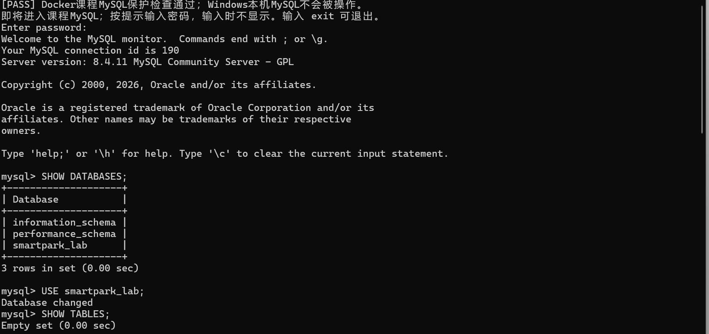
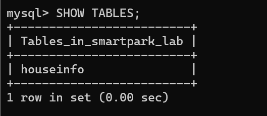
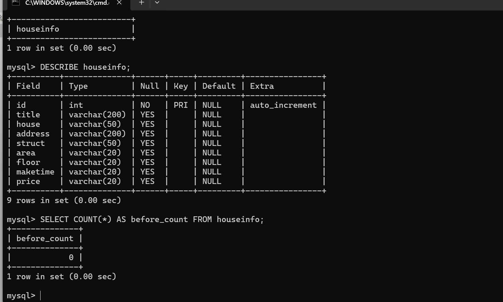
说明：当前使用哪个数据库？`id` 和8个房源字段分别保存什么？
答：smartpark_lab
id，title房源标题,house小区名称,address房源所在地址,struct户型,area房屋面积，floor楼层信息,maketime房屋建造年份,price房屋总价

## 第二阶段：房源采集与 CSV 数据存储

### 1. 网页分析与房源解析

#### 选择器是怎样得到的

在 Chrome 中按 F12，使用 **Elements → Copy → Copy selector**。选一个字段，记录从完整路径到相对选择器的过程。

- 选择的字段：房源标题
- 复制的原始选择器：#__layout > div > section > section.list-main > section.list-left > section:nth-child(4) > div:nth-child(1) > a > div.property-content > div.property-content-detail > div.property-content-title > h3
- 一条房源的父容器选择器：div.property
- 最终使用的相对选择器：h3

**截图：** 框出该字段的 HTML 节点和房源父容器，展示选择器的匹配结果。
文件名：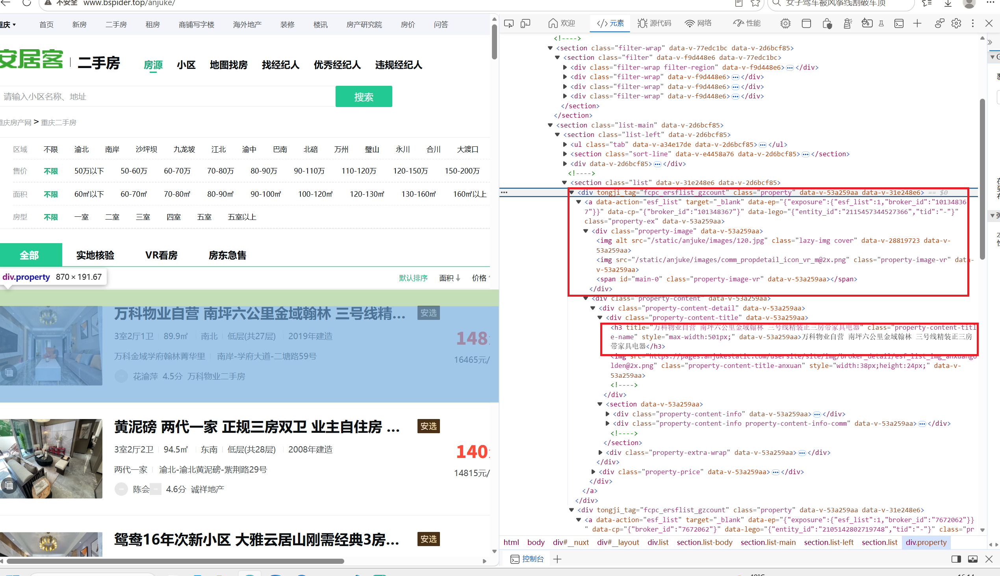

说明：删掉了哪些层级？怎样确认父容器刚好包含一条房源？

答：从标题 `<h3>` 节点向上回溯 DOM 树，舍弃了 `property-content-title`、`property-content` 等中间包装层级，选定 `div.property` 作为房源父容器。
确认父容器匹配规则：在开发者工具中将鼠标悬浮在该节点上，网页高亮区域刚好完整包裹单条房源的全部信息（图片、标题、户型、价格等），不会包含相邻房源；再通过 `soup.select("div.property")` 提取，得到的节点总数和页面房源数量一致，证明该父容器刚好对应一条房源。

#### 解析8个字段

**截图：** 自己编写的解析代码和首条房源的8个字段输出。代码中必须框出：

- `select()` 和 `select_one()`。
- 面积、单价的定位与取值。
- 建造年代的提取和缺失处理。

可分成几张局部截图。另附面积、单价对应的 HTML 节点或网页原文。
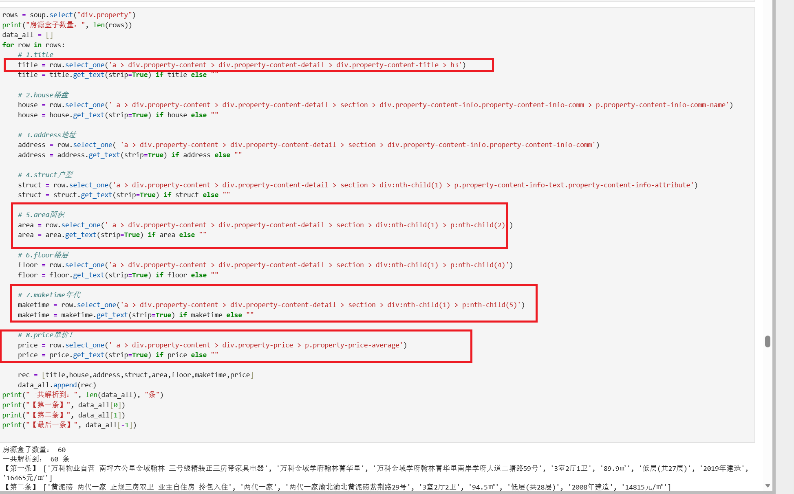
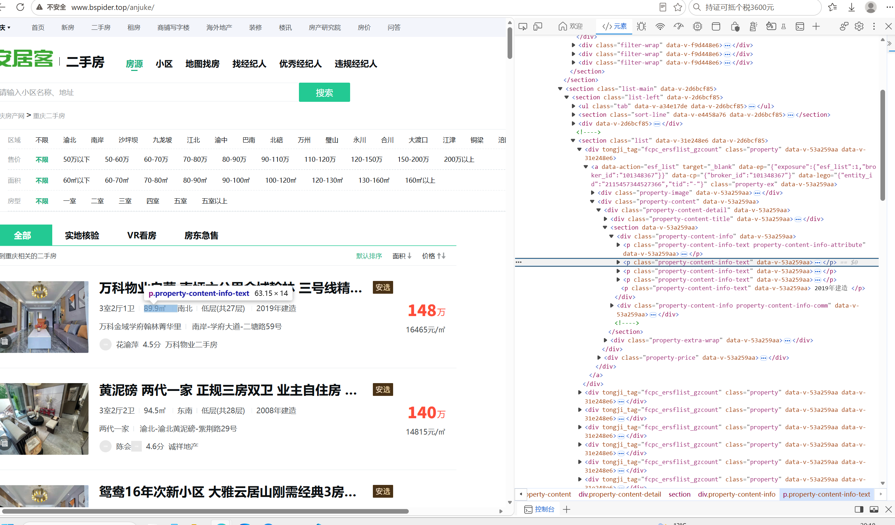
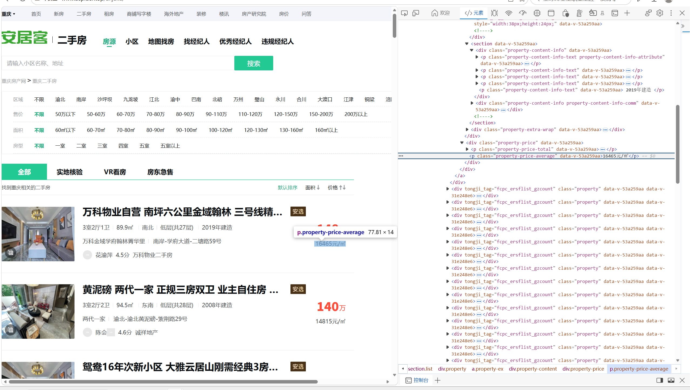


说明：两个选择方法各用在哪里？怎样确认面积和单价没有取错？

答：API 按页码循环：用于 JSON 接口采集，依靠接口返回的总数量计算页数，循环请求；
下一页按钮查找：用于 HTML 网页，通过`select_one`定位下一页链接翻页。
核验面积单价：F12 开发者工具核对 DOM 节点与单位，抽样将网页展示内容与程序输出人工比对，同时读取 CSV 回读复核采集结果。

### 2. 下一页采集

- 下一页 `href` 原值：?page=2
-用 `urljoin()` 补全后的地址：http://www.bspider.top/anjuke/?page=2
- 实际停止原因（明确禁用的末页按钮 / 异常中止）：达到安全页数上限，中止

**截图：** 框出提取 `href`、补全地址、循环更新地址和停止条件的代码。附前两页的运行日志，以及最终停止提示。离线实验展示快照中的href、补全结果和文件读取记录，注明“离线回放”，不算在线翻页成功。
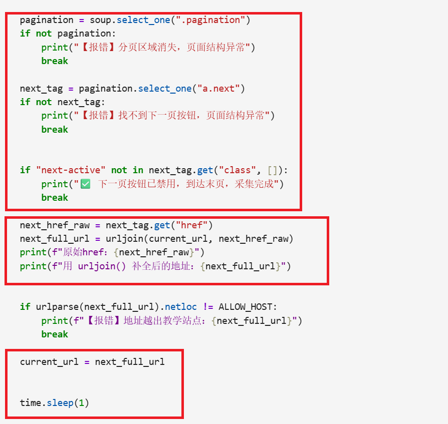

说明：怎样进入下一页？怎样防止重复采集或无限循环？若中途失败，说明停在哪一步。

答：1. **进入下一页**：解析页面找到下一页按钮，提取`href`，通过`urljoin`拼接完整链接；校验域名无误后赋值给`current_url`，延时 1 秒，下一轮循环请求该地址。
2. **防重复、防死循环**：用集合`visited`记录已访问链接，重复则停止；设置`max_pages`页数上限，超出强制中止。
3. **失败停止位置**
- 重复链接：准备发起请求前停止
- 请求报错：发起`requests.get()`时停止
- 分页消失 / 无下一页按钮：当前页解析完毕、查找分页元素阶段停止
- 域名越界：拼接完新链接，域名校验阶段停止
- 页数超限：采集完当前页，翻页前判断超限中止

### 3. 保存 CSV

**截图：** CSV保存与回读代码、回读条数。框出编码、表头和数据写入部分。
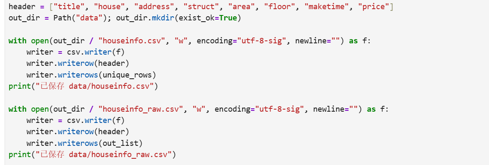
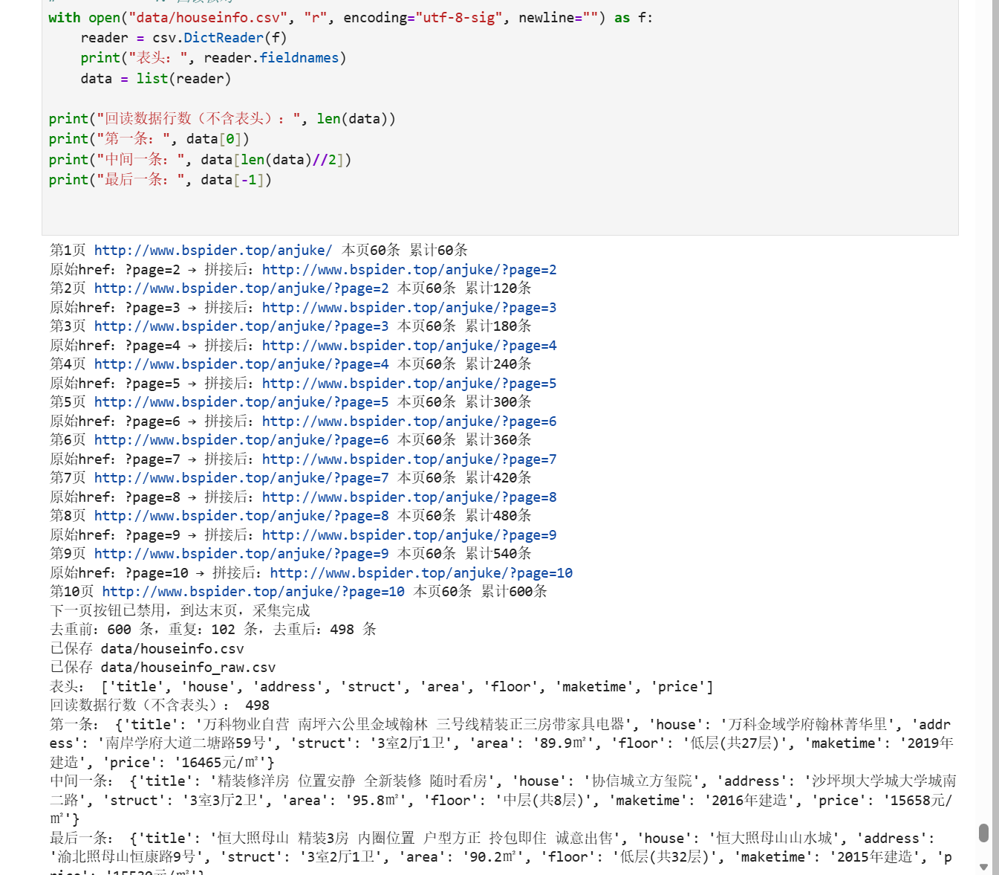

说明：8个字段的顺序是什么？按8个字段完全相同去重后，保存了多少条记录？

答：title,house,address,struct,area,floor,maketime,price；去重后保留498条。

## 第三阶段：MySQL 数据存储

### 1. 读取 CSV 并入库

本阶段读取第二阶段的 `data/houseinfo.csv`，不重新采集。

**截图：** 框出读取CSV、按8个字段整理入库参数的代码。
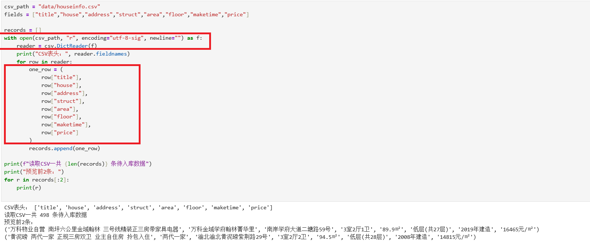

**截图：** 自己编写的入库代码。框出 `executemany()`、`commit()`、`rollback()`，以及关闭游标和连接的操作。另框出避免重复插入的代码。
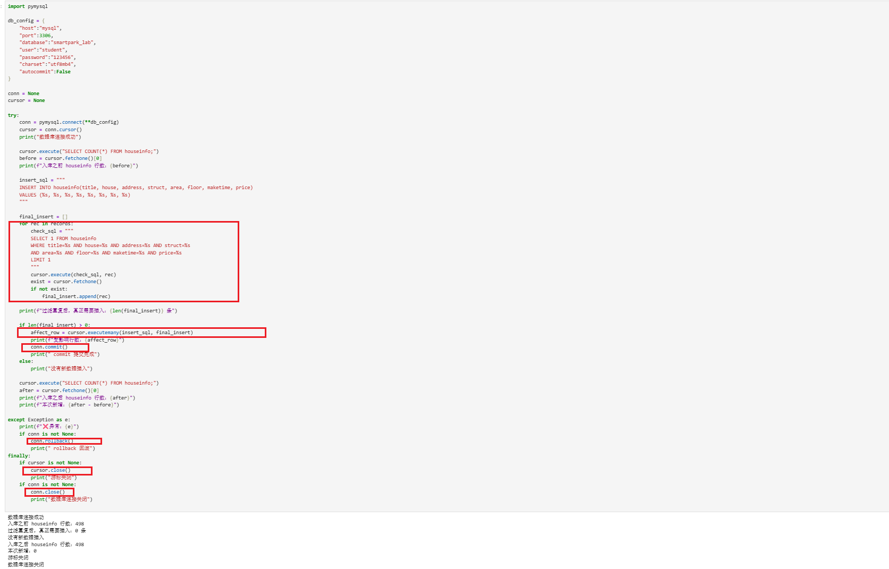

说明：每条记录怎样对应8个参数？成功、失败时分别做什么？再次运行时怎样避免重复插入？

答：读取 CSV 每行，按固定顺序取出八个字段组成元组，和插入语句占位符一一匹配。正常插入完成后执行 `commit` 提交；出现异常则执行 `rollback` 回滚。入库前用全部八个字段比对查询，已存在的记录直接跳过，以此避免重复插入。

### 2. 核对结果

#### 查询条数和样本

**截图：** MySQL 终端中的入库前后 `SELECT COUNT(*)`、重跑后的条数，以及 `SELECT ... LIMIT 5` 的结果。

【在此插入截图】
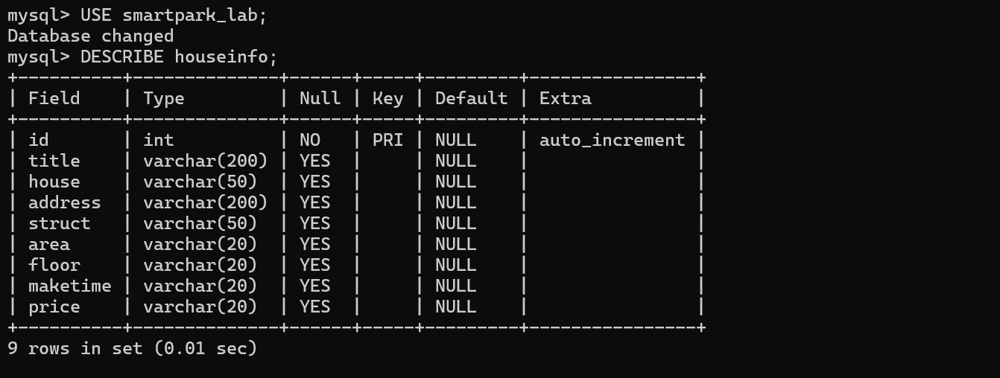
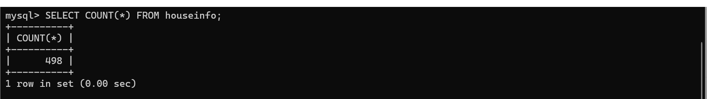
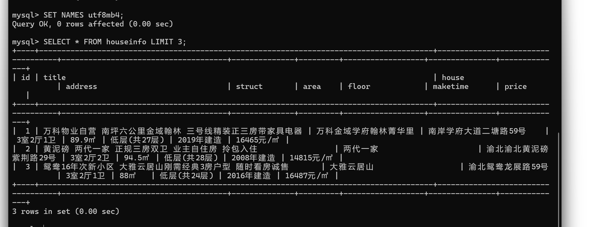
| 项目 | 实际结果 |
|---|---|
| 成功采集页数 |12 |
| 采集记录数（去重前） |600 |
| 完全相同的重复记录数 |102|
| CSV数据行数（不含表头） |498 |
| 入库前条数 | 0|
| 入库后条数 / 本次新增条数 |498 / 498 |
| 关闭上次程序后，同批数据独立重跑的条数 / 新增条数 |498 / 0 |
| 是否采集完整；未完成的原因 |采集完整，无异常 |

说明：首次入库后的条数应等于去重后的CSV数据行数，8个字段的内容也应一致。若不一致，说明原因。总条数以实际结果为准。

答：首次入库之后数据库记录总数等于去重后的 CSV 行数 498，八个字段内容与 CSV 源文件一一对应。重新运行入库脚本时，脚本会使用全部八个字段作为条件比对数据库，已经存在的房源记录会被跳过，因此重跑之后总条数仍然为 498，新增条数为 0，不会产生重复入库。入库采用 utf8mb4 字符集保存中文，保证房源中文信息正常存取。

#### 逐条核对

选取第一条、跨页一条和最后一条，比较网页、CSV与数据库中的8个字段。快照实验对照教师提供的网页文件。

**截图：** 三条样本的对照结果，框出面积、单价和年代。可分图。
- 样本1（页码或URL、记录位置）：来自第 1 页，页面第 1 条
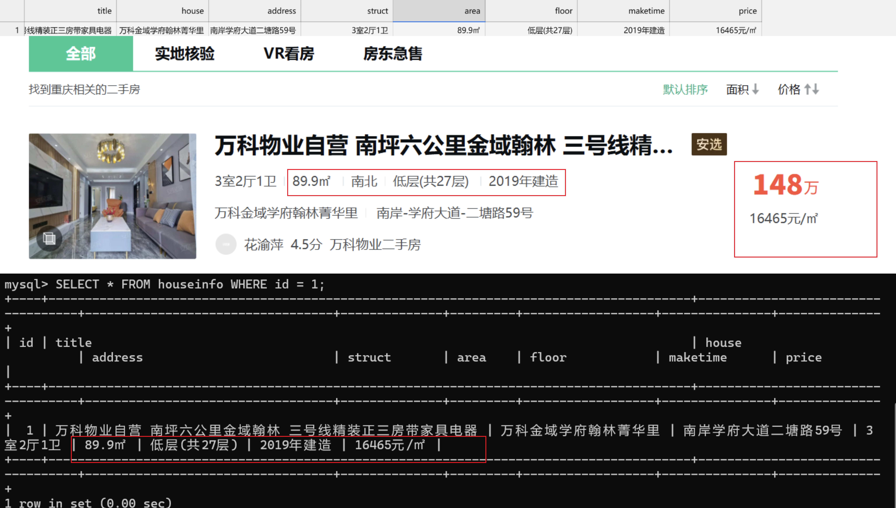
- 样本2（页码或URL、记录位置）：来自第 2 页，页面第 3 条
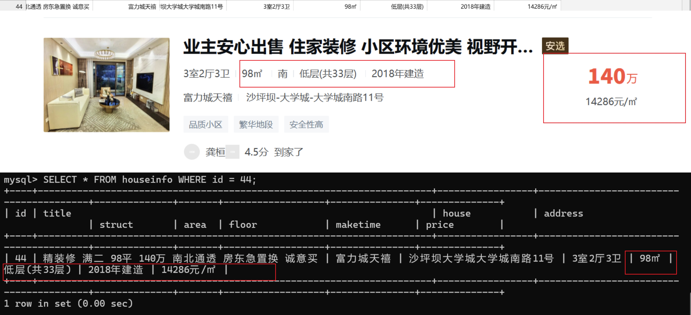
- 样本3（页码或URL、记录位置）：来自第 12 页，页面第 60 条
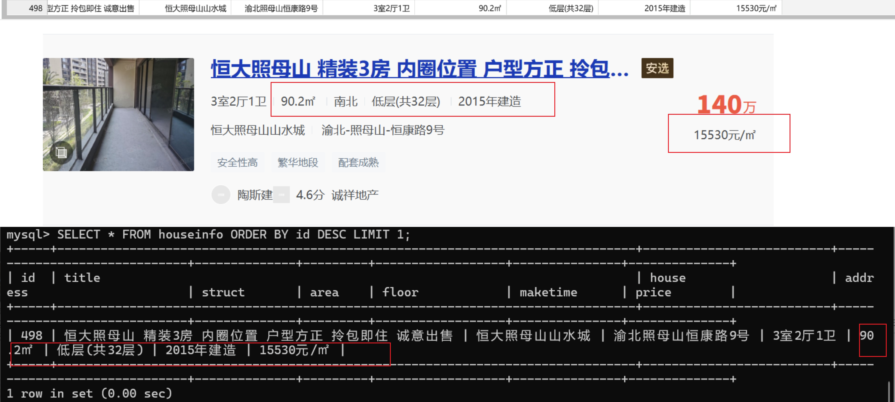

核对结论及差异：
本次选取首条、跨页房源、最后一条房源共三条样本，对照网页快照，对网页、CSV 文件、MySQL 数据库中的八个字段逐一比对。三处来源的标题、小区、地址、户型、面积、楼层、建造年代、单价全部一致；面积、建造年代、单价三处重点字段无乱码、截断、数值错误。说明爬虫抓取、写入 CSV、导入数据库的流程可靠，数据在传输与存储过程中没有丢失或者篡改，采集数据可信。
## 问题与解决

- 遇到的问题、处理方法及结果（没有可写“无”）：无
- 尚未解决的问题、未完成的步骤（没有可写“无”）：无

## 思考题

1. 本次怎样实现下一页采集？结合自己的代码说明。

   答：程序先用 `select_one` 获取分页容器与下一页按钮，检测按钮是否存在、是否带有停止标记，以此判断是否抵达末页。如果可以继续翻页，则提取相对链接，借助 `urljoin` 拼接成完整 URL，更新 `current_url`，加入延时后进入下一轮采集循环，同时校验域名防止跳转至其他站点。
    相关代码：
```python
while True:
    resp = requests.get(current_url)
    soup = BeautifulSoup(resp.text, "html.parser")

    rows = soup.select("div.property")
    for row in rows:
        ...
    pagination = soup.select_one(".pagination")
    if not pagination:
        break
    next_tag = pagination.select_one("a.next")
    if not next_tag:
        break
    if "next-active" not in next_tag.get("class", []):
        break
    next_href_raw = next_tag.get("href")
    next_full_url = urljoin(current_url, next_href_raw)
    if urlparse(next_full_url).netloc != ALLOW_HOST:
        break
    current_url = next_full_url
    time.sleep(1)
```

2. 旧代码把 out_list 定义在全局。你把结果列表放在哪里？为什么？

   答：我将结果列表定义在爬虫函数内部，作为局部变量。
原因：① 如果放在全局，多次运行爬虫时旧数据会残留在列表中，造成数据重复；② 局部变量封装性更好，只在本次采集生命周期内生效，函数执行完毕变量自动回收；③ 避免全局变量被多处代码意外修改，降低程序出错概率，符合模块化的编程思想。

3. 你怎样获取建造年代？节点缺失或顺序改变时，怎样处理？

   答：使用 BeautifulSoup 定位建造年代对应的页面标签，直接调用`get_text(strip=True)`提取文本内容。如果节点缺失，使用三元表达式做容错处理，节点不存在时将该字段赋值为空字符串，不会抛出异常中断整个爬虫程序，保证其余房源可以继续抓取。若页面标签顺序发生改变，若使用固定下标方案会出现字段错位问题，关键字遍历方案则可以抵御标签顺序变动。


